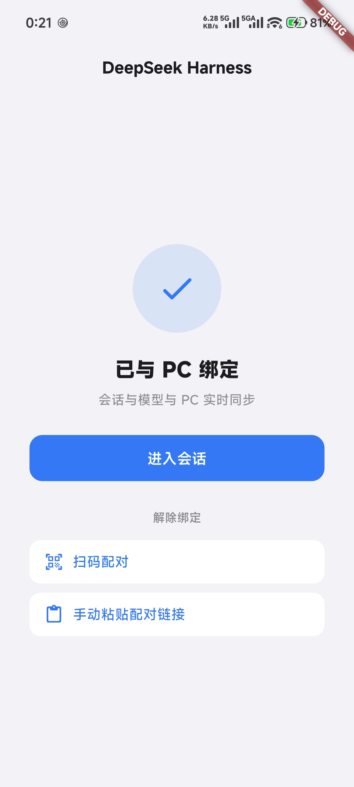
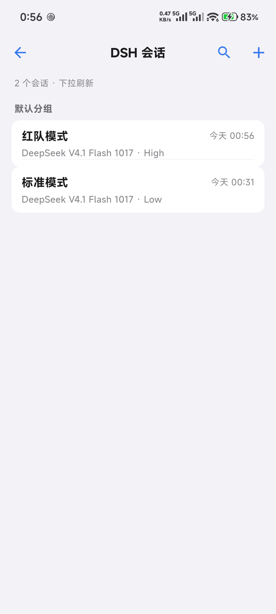

# DeepSeek Harness · dsh app

[简体中文](README.md) | **English**

<p>
  
  
  <a href="../../releases/latest"></a>
  
</p>

Android client for **DeepSeek Harness (dsh)**. Pair once by scanning a QR from the dsh **pairing plugin**, then read and continue your sessions from the phone — over your own LAN, with no cloud relay and no account.

<p align="center">
  
  
</p>

## Install & run · 3 steps

1. **Install the app** — download `dsh-app-release.apk` from [**Releases**](../../releases/latest) (Android 8+).
2. **Install the dsh plugin** — on the PC:
   ```powershell
   git clone -b plugin https://github.com/lrxG/dsh-app dsh-plugin
   ```
   Then **dsh → Plugins → Add plugin** → paste the absolute path of `dsh-plugin` → restart dsh. (Requires `pnpm`; the package declares `dsh.bundle`.)
3. **Pair** — open **dsh → Settings → 扫码配对**, scan the QR with the app. Or paste the URL under the QR via **手动粘贴配对链接**.

Done. Sessions, models and messages sync from the PC; you can keep chatting from the phone.

> The dsh **Desktop app** only listens on `127.0.0.1`. The plugin's built-in **LAN gateway** exposes it to the phone automatically — no extra launcher, no `--host` flag.

## What you get

| | |
|---|---|
| **Sessions** | Same workspace groups as the PC · archive/restore · pin · rename · search (name + content) · subagents · background jobs |
| **Chat** | Streaming replies · reasoning fold · tool-call chips · stop turn · image & file attachments |
| **Models** | Reads the PC catalog · two-level picker (model → effort) · each row shows the model it uses · writes back to the PC |
| **Interaction** | Approval prompts (allow once / reject) · system notifications for approvals and finished answers |
| **Devices** | Remember multiple PCs and switch with one tap |

## Where things live

| Content | Location |
|---|---|
| Android APK (recommended) | [**Releases**](../../releases/latest) |
| App source | this `main` branch (Flutter project at the repo root) |
| dsh pairing plugin | [`plugin` branch](../../tree/plugin) |
| Protocol notes | [`docs/PROTOCOL.md`](docs/PROTOCOL.md) |

## How it works

```
┌──────────── PC ────────────┐                 ┌──────── phone ────────┐
│ dsh (desktop app or CLI)   │                 │  DeepSeek Harness app │
│  ├─ Settings → QR (plugin) │◄── ① scan ──────│                       │
│  ├─ /api  RPC (HTTP)       │◄── ② RPC ───────│  dsh-auth cookie      │
│  └─ /api/remote.mux  (WS)  │◄── ③ streaming ─│  (30 days)            │
│  [plugin LAN gateway]      │                 │                       │
│   LAN IP:3080 → 127.0.0.1  │                 │                       │
└────────────────────────────┘                 └───────────────────────┘
```

- The plugin renders the **live launch token** (`connection.authenticatedUrl`) as a QR — always current.
- The app exchanges that one-time token for a **signed HttpOnly cookie** (30 days). All later RPC / WebSocket calls use only the cookie.
- The signing secret lives on disk, so **restarting dsh or the PC does not require re-scanning**.
- For loopback-only instances the plugin starts a **LAN gateway** (`<LAN-IP>:3080`) that proxies HTTP + WebSocket to the local dsh, rewriting `Host`/`Origin` to `localhost`. dsh still applies its own trust fence and cookie checks.

## Security

- LAN only; no relay, no telemetry.
- QR token: 256-bit random per process, rotates on restart.
- Cookie: signed by a durable PC secret, `HttpOnly`, `SameSite=Strict`, 30 days.
- Every data route passes dsh's `connection.admit()`; anonymous requests get **401**.
- The plugin page can **revoke all devices** (rotates the signing secret).
- Tip: give the PC a static DHCP lease so its IP (and the cookie) stays valid.

## FAQ

**Phone says “connection refused”.** The plugin must be installed and dsh restarted (the gateway only runs with the plugin). On the PC, `http://<PC-IP>:3080/` returning **401** means the gateway is up.

**No QR / warning in dsh settings?** The plugin did not load or the gateway could not bind a port. Restart dsh and check its log for `lanbuddy-pair`.

**Do I re-scan after a reboot?** No. Only re-scan if the cookie expired (30 days), the PC's IP changed, or you used “revoke all devices”.

**Is my data uploaded anywhere?** No. The app only talks to your PC on the LAN.

## Build from source

```powershell
git clone https://github.com/lrxG/dsh-app
cd dsh-app
flutter pub get
flutter analyze
flutter test
flutter build apk --release
# build/app/outputs/flutter-apk/app-release.apk
```

## License

MIT — see [LICENSE](LICENSE).
