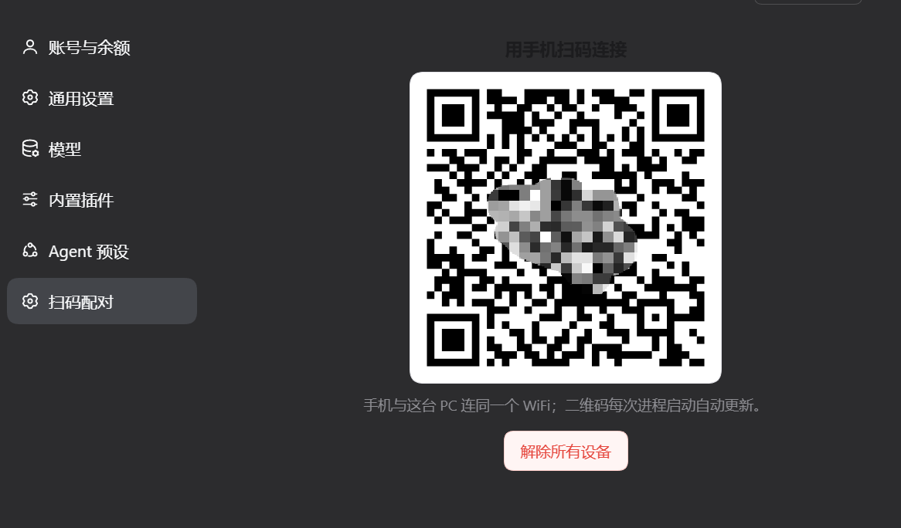

# dsh pairing plugin + Android app

[简体中文](README.md) | **English**

<p>
  <a href="https://github.com/lrxG/dsh-app/releases/latest"></a>
  
  
</p>

Install the app on your phone and this plugin on your PC, scan one QR, and keep working on your dsh sessions from the phone.

This repository holds **two source trees**. They are two halves of one setup, not alternatives:

| Branch | What it is | Runs on | Language |
|---|---|---|---|
| **`main`** (this page) | **PC-side dsh plugin "扫码配对"**: pairing QR, LAN gateway, device revocation | PC | Node / JavaScript |
| **[`app`](../../tree/app)** | **Android client**: sessions, chat, approvals, notifications, attachments | Phone | Dart / Flutter |

The APK always ships from [**Releases**](https://github.com/lrxG/dsh-app/releases/latest) — never from a source tree.

<p align="center">
  
</p>

<p align="center"><sub>Once the plugin is installed and dsh restarted: <b>dsh → Settings → 扫码配对</b> — the QR lives here</sub></p>

## Install · 3 steps

**1. Install the app (phone)**

Download `dsh-app-release.apk` from [**Releases**](https://github.com/lrxG/dsh-app/releases/latest) (Android 8+).

**2. Install the plugin (PC)**

```powershell
git clone https://github.com/lrxG/dsh-app dsh-plugin
```

Then **dsh → Plugins → Add plugin** → paste the absolute path of `dsh-plugin` → restart dsh. (The package declares `dsh.bundle`, which is what the manager looks for.)

> **The plugin manager needs `pnpm`.** If you don't have it: install [Node.js LTS](https://nodejs.org/) (keep clicking Next), then in **PowerShell**:
> ```powershell
> npm install -g pnpm
> ```
> Open a fresh PowerShell and check `pnpm -v` prints a version. Official docs: [pnpm.io/installation](https://pnpm.io/installation).

**3. Pair**

1. Open **dsh → Settings → 扫码配对**
2. Scan the QR with the app, or paste the URL under it via **手动粘贴配对链接**
3. Done — sessions, models and messages sync in real time

The token rotates on every dsh start, but the app keeps a 30-day signed cookie, so restarts do not require re-scanning.

## Getting each source tree

| Goal | Branch | Command |
|---|---|---|
| Change the PC plugin / wire it manually | `main` (this page) | `git clone https://github.com/lrxG/dsh-app` |
| Change the Android app / build an APK | `app` branch | `git clone -b app https://github.com/lrxG/dsh-app` |

- **Just want it working?** Build nothing: get the APK from Releases and install the plugin via step 2.
- **The two trees are independent**: the plugin is a Node package (`package.json` + `lib/` + `cordis.patch.yml`); the app is a Flutter project (`pubspec.yaml` + `lib/` + `android/`).
- **Releases** carry the APK only; no branch contains a built APK.

## What the plugin does

- **Settings page** with the pairing QR (`settings.section`)
- `GET /lanbuddy/pair` — standalone QR page
- `GET /lanbuddy/pair/qr.svg` — QR image (`no-store`)
- `GET /lanbuddy/pair/info` — `{url, host, port, loopback, lan, gateway}`
- `POST /lanbuddy/devices/revoke` — rotate the signing secret (all phones re-pair)
- **LAN gateway** for loopback-only instances

All routes pass `ctx.connection.admit()`, the same Host/cookie fence as `/api`; anonymous requests get **401**.

## How it works

The QR is built from `ctx.connection.authenticatedUrl()` — the same live launch token dsh prints at startup, never stale.

### LAN gateway

When dsh only listens on loopback (the Desktop app), the plugin binds `<LAN-IP>:3080` (next free port when taken) and proxies **HTTP + WebSocket** to the local dsh, rewriting `Host`/`Origin` to `localhost`. The port-less loopback authority keeps cookies valid across desktop restarts.

- Only starts for loopback-only instances
- `lanGateway: false` disables it; `lanHost` / `lanPort` override the bind
- Security is the same as `--host`: the full dsh surface is exposed to the LAN, gated by token/cookie

## Manual wiring

```powershell
New-Item -ItemType Junction `
  -Path "$env:USERPROFILE\.dsh\profiles\<profile>\node_modules\dsh-pair" `
  -Target "D:\path\to\dsh-plugin"
```

```yaml
# cordis.patch.yml
- insert:
    - id: lanbuddy-pair
      name: "dsh-lanbuddy-pair"
```

Restart dsh.

## Security

- No new port besides the gateway
- QR/token served only to an authenticated dsh session
- `cache-control: no-store` everywhere
- “Revoke all devices” deletes the `client-connection/browser-session` credential (restart to apply)

## Troubleshooting

| Symptom | Fix |
|---|---|
| No 「扫码配对」 entry in Settings | Plugin not loaded — check dsh logs, restart |
| Phone: connection refused | Scanned a loopback URL or gateway not running — restart dsh |
| `not-a-bundle` | Package lacks `dsh.bundle`; use the `main` branch |
| `EADDRINUSE` | Another instance holds the port; the gateway falls back automatically |
| Re-scan after a reboot? | No. The cookie lasts 30 days; only IP changes, expiry or “revoke all devices” require a re-scan |

## Uninstall

Remove the bundle in the plugin manager (or delete the patch entry + junction) and restart dsh.

## What the app does

| | |
|---|---|
| **Sessions** | Same workspace groups as the PC · archive/restore · pin · rename · search · subagents · background jobs |
| **Chat** | Streaming replies · reasoning fold · tool-call chips · stop turn · image & file attachments |
| **Models** | Reads the PC catalog · two-level picker (model → effort) · writes back to the PC |
| **Interaction** | Approval prompts · question cards (options / multi-select / free text / skip) · background completion notifications |
| **Devices** | Remember multiple PCs and switch with one tap |
| **Updates** | In-app check for the latest GitHub release · SHA-256 verification · system installer |

Background notifications are main-session only: a finishing subagent never notifies on its own; the whole agent tree must settle first. Swiping the app away drops the socket, so notifications during that window are lost and catch up on reopen.

App source, build instructions and protocol notes live on the [`app` branch](../../tree/app) (`docs/PROTOCOL.md`).

## License

MIT — see [LICENSE](LICENSE).
