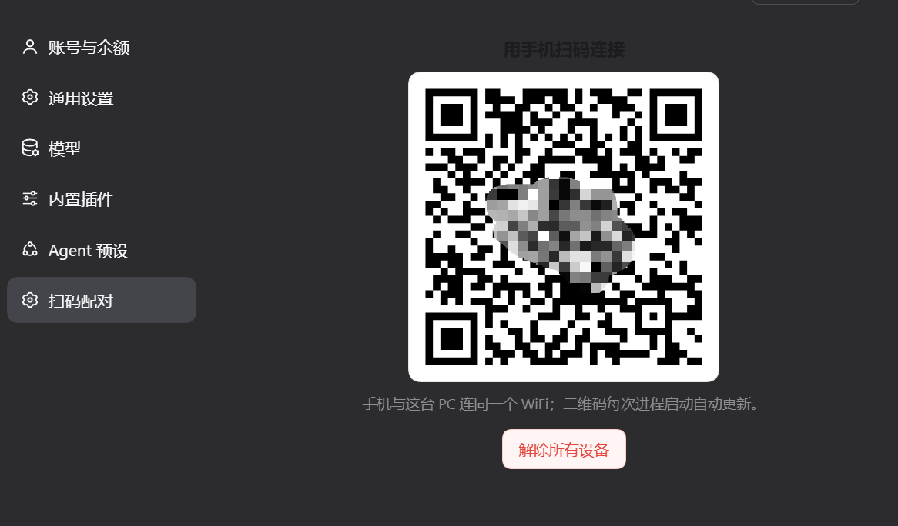

# dsh 扫码配对插件 + Android App

**简体中文** | [English](README.en.md)

<p>
  <a href="https://github.com/lrxG/dsh-app/releases/latest"></a>
  
  
</p>

手机装上 App、电脑装上本插件，扫一次码，就能在手机上继续 PC 上的 dsh 会话。

这个仓库有**两套源码**，不是二选一，是配套使用的两半：

| 分支 | 是什么 | 装在哪 | 语言 |
|---|---|---|---|
| **`main`（当前页）** | **PC 端 dsh 插件「扫码配对」**：出二维码、起局域网网关、管配对设备 | 电脑 | Node / JavaScript |
| **[`app`](../../tree/app)** | **Android 客户端**：会话、聊天、审批、通知、附件 | 手机 | Dart / Flutter |

安装包永远在 [**Releases**](https://github.com/lrxG/dsh-app/releases/latest)，源码树里没有 APK。

<p align="center">
  
</p>

<p align="center"><sub>装好插件并重启 dsh 后：<b>dsh → 设置 → 扫码配对</b>，二维码就在这里</sub></p>

## 下载与安装 · 三步

**1. 装 App（手机）**

到 [**Releases**](https://github.com/lrxG/dsh-app/releases/latest) 下载 `dsh-app-release.apk`（Android 8+）安装。

**2. 装插件（电脑）**

```powershell
git clone https://github.com/lrxG/dsh-app dsh-plugin
```

然后 **dsh → 插件 → 添加插件**，粘贴 `dsh-plugin` 的绝对路径，按提示重启 dsh。（本包声明了 `dsh.bundle`，插件管理器才会接受它。）

> **插件管理器需要 `pnpm`**。没装过的话，先装 [Node.js LTS](https://nodejs.org/)（一路 Next），再在 **PowerShell** 里执行：
> ```powershell
> npm install -g pnpm
> ```
> 关掉重开一个 PowerShell，`pnpm -v` 能打印版本号即可。官方说明：[pnpm.io/installation](https://pnpm.io/installation)。

**3. 配对**

1. 打开 **dsh → 设置 →「扫码配对」**
2. 用 App 扫二维码，或点「手动粘贴配对链接」粘贴二维码下方的链接
3. 完成——会话、模型、消息实时同步

token 每次启动 dsh 都会轮换，但 App 持有 30 天签名 cookie，所以重启不用重扫。

## 两套源码怎么拿

| 你要做什么 | 拿哪份 | 命令 |
|---|---|---|
| 改 PC 插件 / 自己接线 | `main`（本页） | `git clone https://github.com/lrxG/dsh-app` |
| 改 Android App / 自己编译 APK | `app` 分支 | `git clone -b app https://github.com/lrxG/dsh-app` |

- **只要能用**：不用编译任何源码，APK 从 Releases 下，插件按上面第 2 步装。
- **两套源码互不依赖**：插件是 Node 包（`package.json` + `lib/` + `cordis.patch.yml`），App 是 Flutter 工程（`pubspec.yaml` + `lib/` + `android/`）。
- **发版**：APK 走 [Releases](https://github.com/lrxG/dsh-app/releases)，不进任一分支的源码树。

## 插件做什么

- **设置页**显示配对二维码（`settings.section`）
- `GET /lanbuddy/pair` —— 独立二维码页
- `GET /lanbuddy/pair/qr.svg` —— 二维码图片（`no-store`）
- `GET /lanbuddy/pair/info` —— `{url, host, port, loopback, lan, gateway}`
- `POST /lanbuddy/devices/revoke` —— 轮换签名密钥（所有手机重新配对）
- 回环实例自动开**局域网网关**

所有路由都过 `ctx.connection.admit()`，和 `/api` 同一套 Host/cookie 围栏；匿名请求一律 **401**。

## 原理

二维码取自 `ctx.connection.authenticatedUrl()`，也就是 dsh 启动时打印的当前 launch token，永远是最新有效的。

### 局域网网关

dsh 只监听回环（桌面应用）时，插件绑定 `<局域网IP>:3080`（被占用就顺延）并把 **HTTP + WebSocket** 转发给本机 dsh，同时把 `Host`/`Origin` 重写为 `localhost`。无端口号的回环 authority 能让 cookie 在桌面重启后继续有效。

- 只在回环实例上启动
- `lanGateway: false` 可关闭；`lanHost` / `lanPort` 可改地址端口
- 安全口径同 `--host`：整个 dsh 面暴露到局域网，由 token/cookie 把关

## 手动接线

```powershell
New-Item -ItemType Junction `
  -Path "$env:USERPROFILE\.dsh\profiles\<profile>\node_modules\dsh-pair" `
  -Target "D:\path\to\dsh-plugin"
```

```yaml
# cordis.patch.yml
- insert:
    - id: lanbuddy-pair
      name: "dsh-lanbuddy-pair"
```

然后重启 dsh。

## 安全

- 除网关外不新增端口
- 二维码/token 只发给已登录的 dsh 会话
- 所有路由 `cache-control: no-store`
- 「解除所有设备」会删除 `client-connection/browser-session` 凭据（重启后生效）

## 常见问题

| 现象 | 处理 |
|---|---|
| 设置里没有「扫码配对」 | 插件没加载——看 dsh 日志，重启 |
| 手机提示连接被拒绝 | 扫到了回环地址，或网关没起来——重启 dsh |
| 提示 `not-a-bundle` | 包缺 `dsh.bundle`；确认用的是 `main` 分支 |
| `EADDRINUSE` | 端口被另一个实例占用；网关会自动顺延 |
| 重启后要重扫吗 | 不用，cookie 30 天；只有换 IP、过期或点了「解除所有设备」才重扫 |

## 卸载

在插件管理器里移除，或删掉 patch 条目与 junction，然后重启 dsh。

## App 端能做什么

| | |
|---|---|
| **会话** | 与 PC 工作区分组一致 · 归档/恢复 · 置顶 · 重命名 · 搜索 · 子任务 · 后台任务 |
| **聊天** | 流式回复 · 思考折叠 · 工具调用芯片 · 停止 · 图片/文件附件 |
| **模型** | 读取 PC 目录 · 模型 → 思考深度两级选择 · 选择写回 PC |
| **交互** | 审批弹窗 · 提问卡片（选项/多选/自由输入/跳过）· 后台完成通知 |
| **多设备** | 保存多台 PC，一键切换 |
| **更新** | App 内检查 GitHub 最新版、校验 SHA-256、调起系统安装器 |

后台通知只针对主会话：子智能体结束不会单独弹，整棵 agent 树空闲后才提醒一次；`上滑清掉` App 后进程内连接断开，这段时间的通知会漏，重开 App 会补齐。

App 源码、构建方法、协议笔记都在 [`app` 分支](../../tree/app)（`docs/PROTOCOL.md`）。

## 许可证

MIT，见 [LICENSE](LICENSE)。
